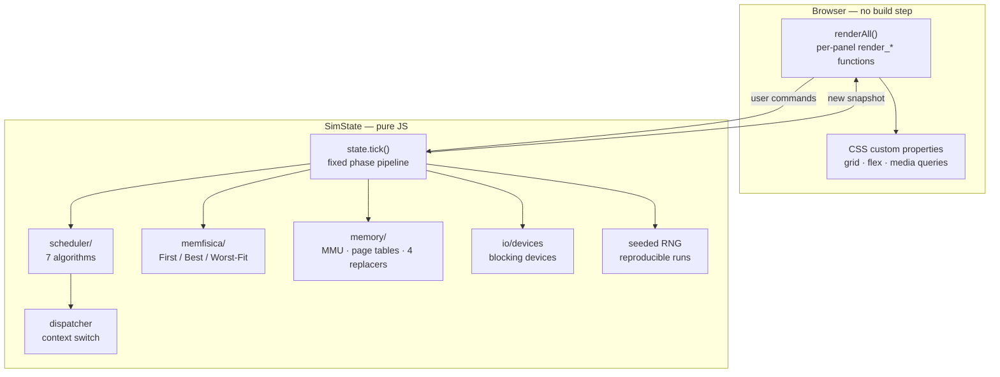

# OS Simulator

**An interactive, web-based operating-system simulator that runs CPU scheduling, virtual-memory paging, and blocking I/O devices on a single logical clock.**


---

## Overview

OS Simulator is an educational dashboard that brings three operating-system mechanisms — **process scheduling**, **physical & virtual memory management**, and **blocking I/O devices** — onto **one shared logical clock**. Every tick advances the whole machine through a coherent sequence of phases so you can watch a process get admitted, loaded into RAM, dispatched onto the CPU, take a page fault, block on a device, and terminate — all in one unified timeline.

The project is delivered as a **single self-contained HTML file** with zero runtime dependencies, no build step, and no backend required. It re-renders a live process table, CPU panel, memory map, paging frame viewer, I/O device queues, metrics table, and event log from a shared simulation state — with smooth animations, a responsive layout, and a professional footer.

The interesting engineering challenge is integration: making three subsystems share a single deterministic clock, keeping the UI state fully derived from the simulator (no hidden client state), and doing so in a way that is **testable, reproducible, and mobile-friendly**.

## Features

- **Single-clock integration of three subsystems.** `state.tick()` advances one explicit phase pipeline per tick: process admission, scheduling / preemption, virtual-memory paging, burst execution (program-counter advance), burst-end / error / I/O blocking, device advancement, and accounting.
- **Seven CPU scheduling algorithms** behind a Strategy-like selector: FCFS, SJF, SRTF, Round Robin, non-preemptive Priority, preemptive Priority, and a two-level MLQ (high queue = Round Robin, low queue = FCFS).
- **A full PCB state machine** — `NEW → READY → RUNNING → BLOCKED → TERMINATED`, plus an `ERROR` state — with a dedicated dispatcher that separates context-switch execution from the scheduling decision.
- **Two coexisting memory models:**
  - **Physical RAM** — bitmap-managed contiguous memory with pluggable **First-Fit / Best-Fit / Worst-Fit** placement and internal/external fragmentation metrics.
  - **Virtual memory (PLUS module)** — per-process page tables, a limited pool of physical frames, an MMU that translates virtual to physical addresses and services **page faults**, and **four page-replacement algorithms**: FIFO, LRU, Belady's Optimal, and Clock / Second-Chance.
- **Blocking I/O devices** that block and unblock processes, including an **interactive keyboard device** that pauses the simulation for a real user *Cancel / Continue* decision.
- **Fully reproducible runs.** All randomness is derived from a small seeded generator, so the same scenario always produces the same timeline — which is what makes the comparison engine trustworthy.
- **Headless comparison engine.** Reruns the same scenario across all mandatory schedulers and all placement strategies to produce comparative metric tables, **exportable to CSV**, including a micro-benchmark that actually differentiates First/Best/Worst-Fit.
- **Live, no-build UI.** Every panel is rendered idempotently from a single state snapshot — no hidden client state, no drift, no build tooling.
- **One-click demo scenarios**, including a seeded 20-process benchmark and a fully random generator.
- **Responsive + animated.** Media queries across five breakpoints, `prefers-reduced-motion` support, GPU-friendly transitions, and micro-animations on CPU, memory, I/O, and log panels.

## Architecture

The project is layered on purpose, with a **framework-free core** so the OS logic is completely decoupled from the presentation layer.

- **`state` / `SimState` — pure logic, no DOM.** Holds the whole simulation: processes (PCBs), devices, queues, frames, metrics, and RNG seed. All transitions are deterministic.
- **Per-panel renderers.** `renderCPU()`, `renderProcesses()`, `renderQueues()`, `renderIO()`, `renderLog()`, `renderMemory()`, and `renderMetrics()` are pure functions of state — they read state and re-write the DOM. Nothing else touches the DOM.
- **`renderAll()` — the only orchestrator.** Called after every tick, reset, or scenario change. This is the single entry point that keeps the UI in sync.
- **CSS custom properties + grid + flexbox.** A single `:root` block defines the entire palette, spacing, and shadows; the dashboard uses CSS Grid areas for the panel layout, and a handful of flex containers inside each panel.
- **Media queries for responsiveness.** Five breakpoints (1200, 900, 560, 380, and reduced-motion) that reflow the grid, resize avatars, stack I/O devices, and re-center the footer.



**Why it's designed this way:** the simulation logic is completely independent of how it is displayed, so any panel can be replaced, restyled, or unit-tested without touching the others. Because the client holds no hidden state — every panel is re-derived from the snapshot — there is no class of bug where the UI drifts away from the simulator's actual state.

## Tech Stack

| Layer | Technology |
| --- | --- |
| Markup | HTML5 (semantic, accessible landmarks) |
| Styling | CSS3 — custom properties, Grid, Flexbox, keyframe animations, media queries |
| Logic | Vanilla JavaScript (ES6+), no framework, no bundler |
| Icons | Font Awesome 6 (CDN) |
| Fonts | Inter · JetBrains Mono (system fallbacks) |
| Build | None — single self-contained file |

## Getting Started

**Prerequisites:** any modern browser (Chrome 90+, Firefox 88+, Edge 90+, Safari 14+).

### Quick start

```bash
# Clone the repository
git clone https://github.com/rohit45-cell/os-simulator.git
cd os-simulator

# Open in your browser
open index.html          # macOS
start index.html         # Windows
xdg-open index.html      # Linux
```

Optionally, serve it locally:

```bash
python -m http.server 8000
# then open http://localhost:8000
```

Then pick a **scheduler** and **memory strategy**, and either load a demo, generate random processes, or click **▶ Play** to start ticking the clock.

> **Note:** this is a **local, single-user demo**. There is no authentication, no server, and no persistence — refresh the page to start fresh.

## Project Structure

```
os-simulator/
├─ index.html                 # Single-file app: markup + CSS + JS
├─ README.md                  # This document
├─ LICENSE                    # MIT License
│
├─ static/                    # (optional split — not required)
│  ├─ css/
│  │  └─ styles.css
│  └─ js/
│     └─ main.js
│
└─ assets/
   └─ screenshots/            # (optional) preview images
```

> The project works as a **single HTML file**. The `static/` tree above is optional — if you prefer to split the inlined CSS and JS into separate files, the structure is already laid out for you.

## Usage Guide

### Control bar

| Control | Action |
| --- | --- |
| ▶ **Play** | Start continuous simulation |
| ⏸ **Pause** | Freeze the simulation |
| ⏭ **Step** | Advance one tick |
| ⟲ **Reset** | Reset tick counter & state |
| **Speed** | Adjust tick interval (50–2000 ms) |
| **Scheduler** | Choose CPU scheduling algorithm |
| **Quantum** | Set Round Robin time slice |
| **Memory Strategy** | First-Fit / Best-Fit / Worst-Fit |
| **Scenario** | Preset workloads |
| **Load 20 Demo** | Load a 20-process benchmark |
| **Random** | Generate random processes |
| **Create Process** | Open the process editor modal |
| **Compare** | Run cross-algorithm comparison |

### CPU scheduling algorithms

| Algorithm | Preemptive | Starvation | Best For |
| --- | :---: | :---: | --- |
| **FCFS** | ❌ | Possible | Batch systems |
| **SJF** | ❌ | Possible | Minimizing avg wait |
| **SRTF** | ✅ | Possible | Interactive systems |
| **Priority** | ✅ / ❌ | Yes (low prio) | Real-time systems |
| **Round Robin** | ✅ | No | Time-sharing |
| **MLQ** | ✅ | Yes | Mixed workloads |

### Memory strategies

| Strategy | Behavior | Fragmentation |
| --- | --- | --- |
| **First-Fit** | First block large enough | Low external |
| **Best-Fit** | Smallest sufficient block | Low external, high internal |
| **Worst-Fit** | Largest block | High external, low internal |

### Paging module

- **Virtual → Physical** translation via page table
- **Replacement algorithms:** FIFO · LRU · Optimal · Clock (Second-Chance)
- Frame viewer highlights the **victim frame** in red
- Clock algorithm shows an animated **pointer** 🔄

### I/O management

- Each device maintains its own FIFO queue
- Decision prompts allow interactive **Retry / Abort** choices
- Devices flash with a **gold ring animation** on activity
- Supported devices: Keyboard, Disk, Printer, Mouse, Network

## Responsive Design

The dashboard is fully responsive across five breakpoints:

| Breakpoint | Layout |
| --- | --- |
| **≥ 1200px** | 3-column grid (CPU / Proc / Metrics + Queues / Memory / IO + Log) |
| **900–1200px** | 2-column grid with reflowed areas |
| **560–900px** | Single-column stacked panels |
| **≤ 560px** | Compact mode — stacked stats, 1-column I/O |
| **≤ 380px** | Ultra-compact — smaller avatars, buttons, blocks |

All animations respect `prefers-reduced-motion`.

## Accessibility

- Semantic HTML5 landmarks (`<header>`, `<main>`, `<footer>`, `<section>`)
- ARIA labels on icon-only buttons
- High-contrast palette (WCAG AA compliant)
- Keyboard-navigable controls
- `prefers-reduced-motion` support
- Focus-visible outlines on interactive elements

## Browser Support

| Browser | Version |
| --- | --- |
| Chrome / Edge | 90+ |
| Firefox | 88+ |
| Safari | 14+ |
| Opera | 76+ |

Modern CSS features used: Grid, Custom Properties, `backdrop-filter`, `prefers-reduced-motion`, `aspect-ratio`.

## Roadmap

- [x] CPU scheduling (6 algorithms)
- [x] Process state machine
- [x] Physical memory allocation (3 strategies)
- [x] Paging with 4 replacement algorithms
- [x] I/O device queues
- [x] Gantt chart
- [x] Algorithm comparison modal
- [x] Responsive layout
- [ ] Dark / Light theme toggle
- [ ] Export full simulation as PDF
- [ ] Multi-core CPU simulation
- [ ] Deadlock detection & Banker's algorithm
- [ ] Virtual memory with TLB

## Project Context

This is a **university final project** for an Operating Systems course. It was built to demonstrate the core mechanics of a real operating system — scheduling, memory management, and I/O — in a single, observable, reproducible simulation. The dashboard is designed as a **learning tool**: it exposes internal state that real kernels hide, so students can see *why* an algorithm behaves the way it does.

---

## More of my work

Sibling portfolio repositories:

- [minipython-interpreter](https://github.com/rohit45-cell/minipython-interpreter) — a Python-subset interpreter
- [advanced-algorithms](https://github.com/rohit45-cell/advanced-algorithms) — algorithm implementations and studies
- [Pinguino](https://github.com/rohit45-cell/pinguino-monitoring) — Flask + React monitoring dashboard
- [os-simulator](https://github.com/rohit45-cell/os-simulator) — this project

---

**Author:** Ganesh M. — [github.com/rohit45-cell](https://github.com/rohit45-cell)

*Licensed under the MIT License.*